<picture><source media="(prefers-color-scheme: dark)" srcset="assets/hero-dark.svg?v=3941be56"></picture>

<picture><source media="(prefers-color-scheme: dark)" srcset="assets/social-l-dark.svg"></picture><a href="https://t.me/"><picture><source media="(prefers-color-scheme: dark)" srcset="assets/social-1-dark.svg"></picture></a><a href="https://discord.com/"><picture><source media="(prefers-color-scheme: dark)" srcset="assets/social-2-dark.svg"></picture></a><a href="https://wa.me/"><picture><source media="(prefers-color-scheme: dark)" srcset="assets/social-3-dark.svg"></picture></a><picture><source media="(prefers-color-scheme: dark)" srcset="assets/social-r-dark.svg"></picture>

<picture><source media="(prefers-color-scheme: dark)" srcset="assets/about-dark.svg"></picture>

<picture><source media="(prefers-color-scheme: dark)" srcset="assets/quote-dark.svg?v=f0203a6d"></picture>

<picture><source media="(prefers-color-scheme: dark)" srcset="assets/stack-dark.svg"></picture>

<a href="https://github.com/RakaMC2/Crates-Add-ons"><picture><source media="(prefers-color-scheme: dark)" srcset="assets/project-crates-add-ons-dark.svg"></picture></a>&nbsp;<a href="https://github.com/RakaMC2/RakaMC2"><picture><source media="(prefers-color-scheme: dark)" srcset="assets/project-rakamc2-dark.svg"></picture></a>

<a href="https://github.com/RakaMC2/myhtml"><picture><source media="(prefers-color-scheme: dark)" srcset="assets/project-myhtml-dark.svg"></picture></a>&nbsp;<a href="https://github.com/RakaMC2/One-Line-Solver"><picture><source media="(prefers-color-scheme: dark)" srcset="assets/project-one-line-solver-dark.svg"></picture></a>

<picture><source media="(prefers-color-scheme: dark)" srcset="assets/stats-dark.svg"></picture>

<picture><source media="(prefers-color-scheme: dark)" srcset="assets/streak-dark.svg"></picture>

<picture><source media="(prefers-color-scheme: dark)" srcset="assets/wave-dark.svg"></picture>

<a href="https://rakzvolt.my.id"><picture><source media="(prefers-color-scheme: dark)" srcset="assets/button-1-dark.svg"></picture></a>&nbsp;&nbsp;<a href="https://github.com/RakaMC2?tab=repositories"><picture><source media="(prefers-color-scheme: dark)" srcset="assets/button-2-dark.svg"></picture></a>

